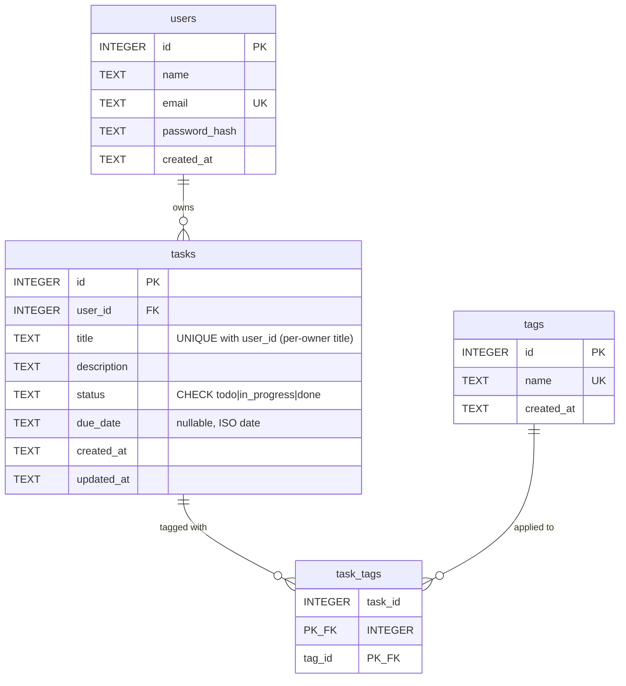

# M06 — SQL Fundamentals with SQLite

Practical module for the Node.js Developer Training program: design a small relational schema
and write the SQL to query it by hand, before Prisma hides the SQL in M07.

**Deliverables in this folder:** the `users` / `tasks` / `tags` / `task_tags` schema, its seed
data, 21 graded query exercises, a Mermaid ERD, and a working SQL-injection demo with its fix.

## Requirements

- The **sqlite3 CLI** (any recent version; built on 3.54.1 here) — `sqlite3 --version` to check.
- **Node 24** for the injection demo only (it uses the built-in `node:sqlite` module; no npm
  install, no dependencies). On this machine: `fnm exec --using=24 -- node injection-demo.mjs`.
- Nothing else. SQLite stores everything in one file: `task.db` (gitignored — you build it).

## Files

| File                 | What it is                                                          |
| -------------------- | ------------------------------------------------------------------- |
| `schema.sql`         | DDL: four tables, constraints, FKs, join indexes — creates the schema |
| `seed.sql`           | Deterministic seed: 4 users, 18 tasks, 7 tags, 30 junction rows      |
| `exercises.sql`      | 21 graded query exercises, numbered 1–21, run in order               |
| `injection-demo.mjs` | Self-verifying SQL-injection demo: vulnerable vs parameterised       |

## Quick start

```bash
# 1. build the database (from this folder)
(cat schema.sql seed.sql) | sqlite3 task.db

# 2. run the graded exercises (read Q1-Q15 first; 16, 17, 19, 21 modify the db)
sqlite3 task.db < exercises.sql

# 3. run the injection demo
fnm exec --using=24 -- node injection-demo.mjs

# any time — reset to the pristine seed
rm task.db && (cat schema.sql seed.sql) | sqlite3 task.db
```

Running interactively instead? `sqlite3 task.db`, then `.read schema.sql`, `.read seed.sql`.
The `.read` keeps one connection, so the `PRAGMA foreign_keys = ON` set inside those files
applies. **A fresh `sqlite3 task.db` session starts with foreign keys OFF again** — re-run the
PRAGMA there before any DML you want enforced. It is per-connection, every connection, forever.

## Schema

### ERD (matches `schema.sql`)



Composite-key notes Mermaid cannot draw:

- `task_tags` has a **composite primary key** `(task_id, tag_id)` — the pair must be unique and
  neither column may be NULL. That single constraint is what makes "same task, same tag twice"
  impossible.
- `tasks` has `UNIQUE (user_id, title)` — one owner cannot hold two tasks with the same title,
  but two different owners may. The seed keeps every title globally unique anyway, so M05's
  stricter global 409 rule is never contradicted by seed data; the cross-owner allowance is
  proven live in `evidence/m06/constraint-proofs.txt` (TEST 6), not by seed rows.

### Design decisions worth defending

- **Keys:** `INTEGER PRIMARY KEY` on every entity table — it aliases SQLite's hidden `rowid`,
  so ids auto-generate and lookup on the PK is direct. Foreign keys are plain `INTEGER`
  columns constrained with `FOREIGN KEY … REFERENCES`.
- **`ON DELETE` is chosen per relation, not by habit:**
  - `tasks.user_id → users.id` **CASCADE** — deleting a user takes their tasks (and, one level
    further, their `task_tags` rows) with them. No orphans.
  - `task_tags.task_id → tasks.id` **CASCADE** — junction rows are meaningless without their task.
  - `task_tags.tag_id → tags.id` **RESTRICT** — a tag still attached to tasks *cannot* be
    deleted; an unused tag deletes fine. Deliberate contrast pair: try both in a session.
- **`status` is `TEXT` + `CHECK (… IN ('todo','in_progress','done'))`** — SQLite has no enum
  type; the constraint *is* the enum.
- **Only join-path indexes are built up front** (`idx_tasks_user_id`, `idx_task_tags_tag_id`).
  `tasks.status` is intentionally left unindexed so exercise 18 can show a `SCAN` and exercise
  19 can build the index and show the `SEARCH` it buys.

## Graded exercises

`exercises.sql` — 21 exercises, run in order, covering every required category:

| Range   | Category                                   | Count |
| ------- | ------------------------------------------ | ----- |
| Q1–Q3   | filtering (`WHERE`, `AND/OR/LIKE`, `IS NULL`) | 3 |
| Q4–Q6   | sorting + pagination (incl. keyset)        | 3     |
| Q7–Q10  | `INNER JOIN` / `LEFT JOIN`                 | 4     |
| Q11–Q13 | aggregates with `GROUP BY` / `HAVING`      | 3     |
| Q14–Q15 | subqueries (`IN`, correlated `NOT EXISTS`) | 2     |
| Q16–Q17 | `UPDATE` / `DELETE` (+ cascade proof)      | 2     |
| Q18–Q19 | indexes + `EXPLAIN QUERY PLAN` before/after | 2    |
| Q20–Q21 | transactions (`ROLLBACK` / `COMMIT`)       | 2     |

Each exercise carries a `GRADED:` comment stating exactly what the result must be (row count,
ids, first row) — check yourself before reading the answer note. Q1–Q15 are read-only; Q16, Q17,
Q19, Q21 modify the database (the header documents the exact post-run state and the reset).

## SQL-injection demo

```bash
fnm exec --using=24 -- node injection-demo.mjs
```

Three rounds in one self-verifying run (exit 0 = all three behaved):

1. **Vulnerable** — a login query built by string concatenation. Payload `' OR 1=1 -- ` closes
   the quote, forces the WHERE to `1=1`, and comments out the password check: **4 rows, login
   bypassed**.
2. **Parameterised** — the identical payload bound as a value (`?` placeholders): **0 rows,
   blocked**. The driver sends SQL and data separately, so input can never become code.
3. **Legitimate login** through the same parameterised query: **1 row** — parameters preserve
   intended behaviour; they only stop *interpretation* of input as SQL.

## Evidence

Trainer evidence (full transcripts of every run) lives in `evidence/m06/` at the repository
root — gitignored, INDEX.md-indexed. This repo carries the exercises themselves; their
branch/PR history is the public checkpoint trail.
