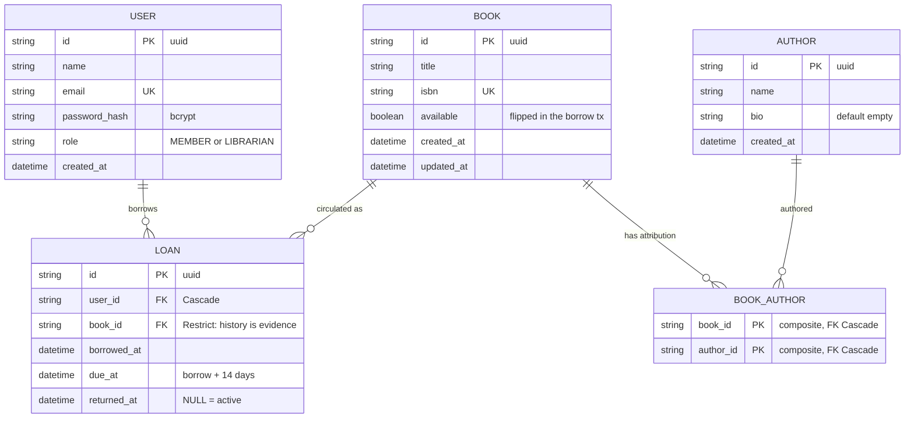

# M10 Capstone — Library REST API

The capstone module of the Node.js training program: a **library catalog API**
with bcrypt password hashing, JWT bearer authentication, role-based
authorization (`MEMBER` vs `LIBRARIAN`), Zod-validated input at every boundary,
and a borrow/return business rule that is **transactionally enforced and proven
under parallel load**.

**Stack:** Node 24 · Express 5 · TypeScript 7 (strict, zero `tsc --noEmit`) ·
Prisma 7 + SQLite · Zod 4 · Jest 30 + Supertest 7 · Bruno (collection in
[`bruno/`](bruno/)). No Docker required.

---

## Setup

```bash
# 1. Node 24 (fnm; the program pins the toolchain per module)
fnm use 24.21.0            # or any Node >= 24

# 2. Install dependencies
npm install

# 3. Environment: copy the example and adjust as needed
#    (gitignored — never committed)
#    .env.example -> .env
#    DATABASE_URL="file:./dev.db" is the default

# 4. Create the schema and load demo data
npm run db:deploy          # apply migrations to dev.db
npm run db:seed            # 2 users (member + librarian), authors, books, loans

# 5. Run
npm run dev                # http://localhost:3000
curl http://localhost:3000/health   # {"status":"ok","uptime":…}
```

Seeded accounts:

| Role      | Email                     | Password             |
| --------- | ------------------------- | -------------------- |
| MEMBER    | `member@library.test`     | `member-pass-123`    |
| LIBRARIAN | `librarian@library.test`  | `librarian-pass-123` |

> Self-registration always mints `MEMBER` (the register schema has **no role
> field** — anti-mass-assignment); librarians are provisioned by the seed.

## Scripts

| Script                | What it does                                            |
| --------------------- | ------------------------------------------------------- |
| `npm run dev`         | Dev server with reload (`tsx watch`)                    |
| `npm start`           | Run the server once                                     |
| `npm test`            | Jest integration suite (sequential)                     |
| `npm run test:coverage` | Jest + coverage (80% branch gate on routes/services)  |
| `npm run test:bruno`  | Run the committed Bruno collection (needs the server up)|
| `npm run typecheck`   | `tsc --noEmit` — must be 0 errors                       |
| `npm run prove:race`  | Before/after concurrency proof against a contested book |
| `npm run db:deploy`   | Apply pending migrations                                |
| `npm run db:migrate`  | Create a new migration (dev)                            |
| `npm run db:reset`    | Reset + reseed the database                             |
| `npm run db:seed`     | Wipe and recreate the demo catalog (fresh seed)         |
| `npm run db:studio`   | Prisma Studio                                            |
| `npm run db:generate` | Regenerate the Prisma client                            |

## Endpoints

All bodies/params/queries/env are Zod-validated; every error answers the shared
envelope `{"error": {"code", "message", "requestId"[, "details"]}}`.

| Method | Path                        | Auth           | Description                                              |
| ------ | --------------------------- | -------------- | -------------------------------------------------------- |
| `GET`  | `/health`                   | public         | Liveness: `{status, uptime}`                             |
| `POST` | `/api/v1/auth/register`     | public         | Create account → `{token, user}` · rate-limited          |
| `POST` | `/api/v1/auth/login`        | public         | `{email, password}` → `{token, user}` · rate-limited     |
| `GET`  | `/api/v1/books`             | any identity   | **List**: filter `title`/`authorId`/`available`, sort `title`\|`createdAt` + `order`, offset `page`/`pageSize` → `{items, meta}` |
| `GET`  | `/api/v1/books/:id`         | any identity   | Book detail incl. `authors[]`                            |
| `POST` | `/api/v1/books`             | **LIBRARIAN**  | Create (optional `authorIds[]` M:N links) → 201         |
| `PATCH`| `/api/v1/books/:id`         | **LIBRARIAN**  | Partial update; `authorIds` replaces the set             |
| `DELETE`| `/api/v1/books/:id`         | **LIBRARIAN**  | Delete → 204; **409** if the book has loan history       |
| `GET`  | `/api/v1/authors`           | any identity   | List authors (name asc)                                  |
| `GET`  | `/api/v1/authors/:id`       | any identity   | Author detail incl. `books[]`                            |
| `POST` | `/api/v1/authors`           | **LIBRARIAN**  | Create → 201                                             |
| `PATCH`| `/api/v1/authors/:id`       | **LIBRARIAN**  | Partial update (≥1 field)                                |
| `DELETE`| `/api/v1/authors/:id`       | **LIBRARIAN**  | Delete → 204 (junction cascades; books survive)          |
| `GET`  | `/api/v1/loans`             | any identity   | **Own** loans, newest first (the `where` is the authz)   |
| `POST` | `/api/v1/loans`             | any identity   | Borrow `{bookId}` → 201; **409** while an active loan exists |
| `POST` | `/api/v1/loans/:id/return`  | owner or LIBRARIAN | Return → 200; **409** on double return, **403** on someone else's loan |

Authorization answers are distinct: **401** = credential missing/unusable,
**403** = authenticated but wrong role/owner. Anonymous callers always get 401
first.

```bash
# Get a token and use it
TOKEN=$(curl -s -X POST localhost:3000/api/v1/auth/login \
  -H 'Content-Type: application/json' \
  -d '{"email":"librarian@library.test","password":"librarian-pass-123"}' \
  | node -pe 'JSON.parse(require("fs").readFileSync(0)).token')

curl -s localhost:3000/api/v1/books?available=true \
  -H "Authorization: Bearer $TOKEN"
```

## Rate limiting

`/api/v1/auth/register` and `/api/v1/auth/login` share one
`express-rate-limit` budget (`RATE_LIMIT_WINDOW_MS`, `RATE_LIMIT_MAX`). A trip
answers **429 through the same envelope** (`code: RATE_LIMITED` + requestId)
and sends the draft `RateLimit-*` headers. Verified live: 10 requests pass
(401s for bad passwords), the 11th is:

```json
{"error":{"code":"RATE_LIMITED","message":"Too many requests, try again later","requestId":"…"}}
```

No other endpoint is rate-limited (proved by test: `/health` stays open).

## The borrow rule and its proof

A book with an **active loan** (`returned_at IS NULL`) cannot be borrowed
again. The check + loan insert + availability flip happen inside one
`prisma.$transaction` in [`src/services/loan.service.ts`](src/services/loan.service.ts).

```bash
npm run prove:race    # ~20 parallel requests at ONE contested book
```

The script first runs a **naive check-then-write** (no transaction, with a
disclosed latency window modeling deployed I/O between check and write), then
the **real application** under the same load, and asserts both claims:

```text
BEFORE — naive check-then-write (no transaction), 20 parallel POST /naive-loans:
  201 (created): 20        loans rows for the contested book: 20
AFTER — fixed service (prisma.$transaction), 20 parallel POST /api/v1/loans:
  201 (created): 1         409 (refused): 19
  loans rows for the contested book: 1
PROOF HELD: before double-booked (20 winners → 20 loans), after kept exactly one winner (1×201, 19×409, 1 loan).
```

## ERD



Delete policies: deleting a **book** with loan history is refused (409,
`Restrict`); deleting a **book** unlinks its author rows (`Cascade`); deleting
an **author** cascades only the junction — the books survive.

## Testing

```bash
npm test               # 109 integration tests (supertest through the full app)
npm run test:coverage  # routes 100%, services 98%+ — 80% floor per file
npm run test:bruno     # 31-request collection against a running server
```

The suite covers: envelope contract, env invariants, auth (hashing proven at
the row, anti-enumeration 401s, JWT failure modes), guard (401×5 modes, 403 vs
200), live rate limiting at `max=3`, full CRUD on both resources with role
gates on real endpoints, the graded list endpoint (filters/sort/pages/int
gates), the loan rule **including five parallel borrows → exactly 1×201 +
4×409**, and coverage-critical paths.

## Layout

```text
src/
  app.ts              middleware chain + routers + central handler
  config.ts           env via Zod, fail-fast
  db.ts               Prisma singleton
  errors.ts           AppError hierarchy + code set
  lib/                jwt, prisma-error mapping
  middleware/         request-id, validate, auth guards, not-found, error-handler
  routes/             auth, books, authors, loans
  schemas/            Zod contracts (body, params, query)
  services/           auth, book, author, loan (transactions live here)
prisma/               schema, migrations, seed
scripts/prove-race.ts before/after concurrency evidence
bruno/                committed collection (31 requests)
tests/                integration suite
```
